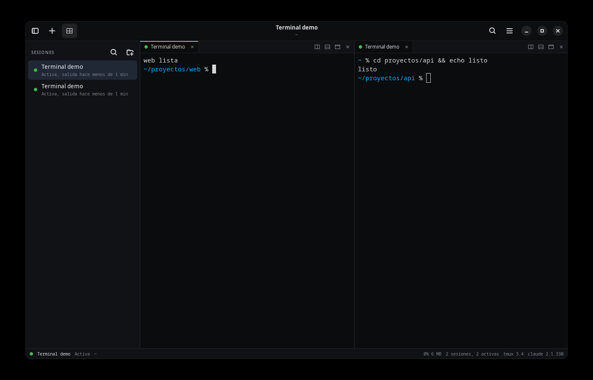
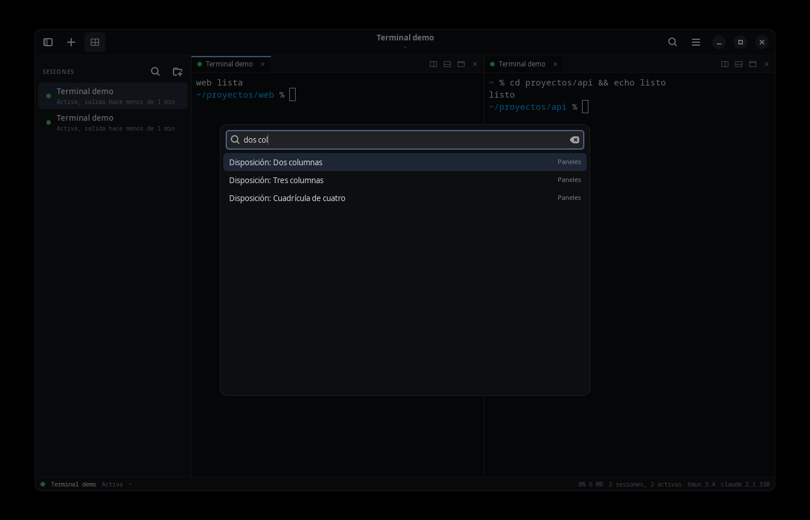
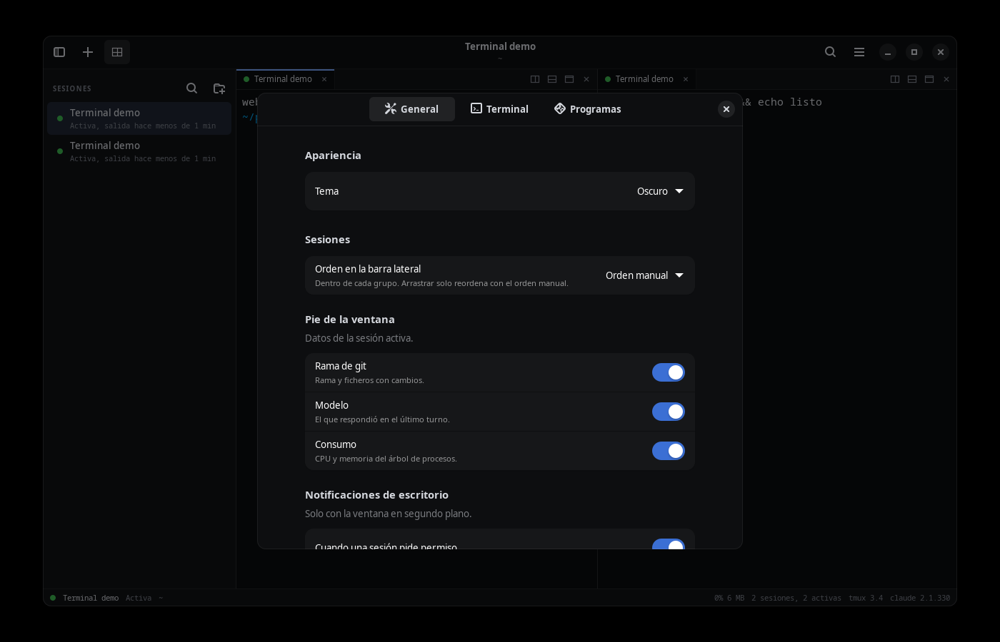
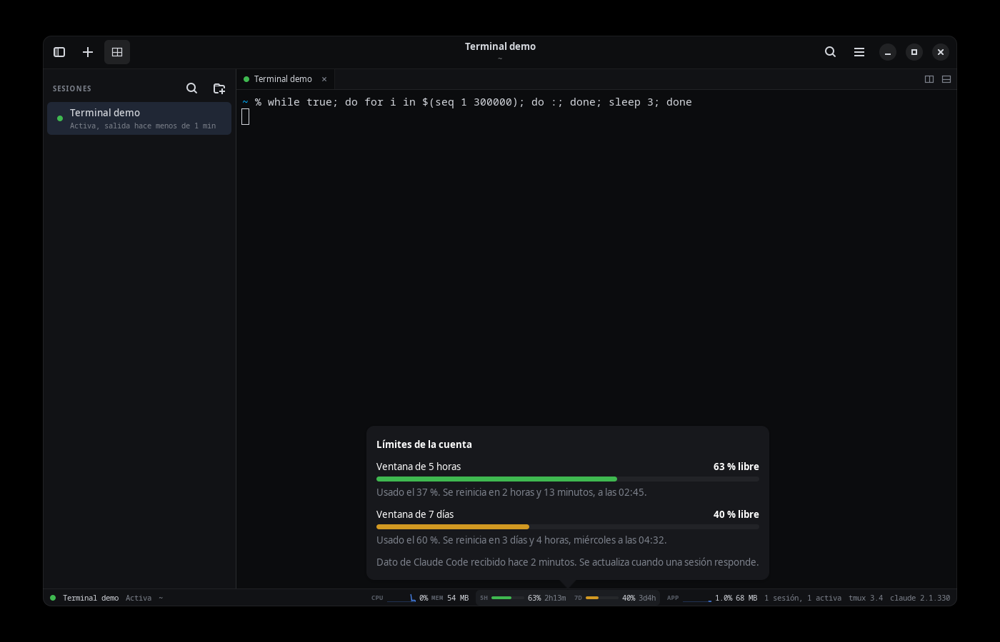
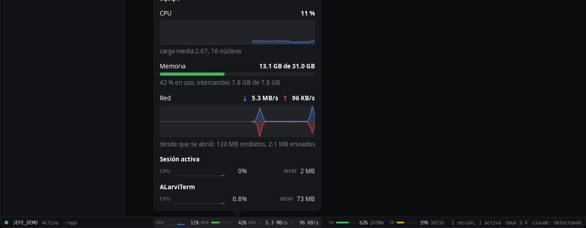
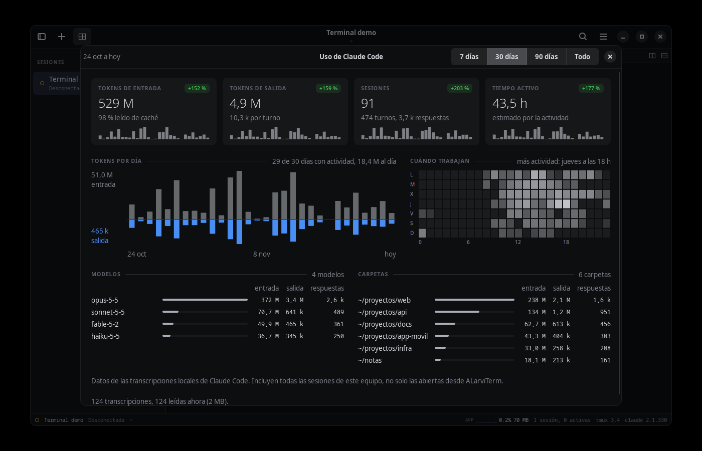
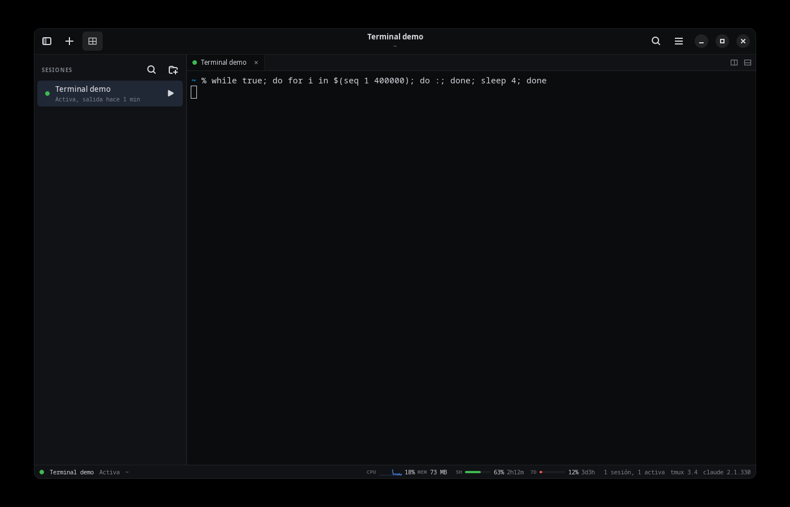

# ALarviTerm

Centro de control nativo para sesiones de Claude Code en Linux. Escrito en Rust con GTK4, libadwaita y VTE, con tmux manteniendo vivos los procesos.

Cada sesión es un proceso real en una terminal real. Si cierras la ventana, Claude Code sigue trabajando, y al volver a abrirla te reconectas donde estaba.



Estado actual: versión 0.1.0, funcional y en desarrollo. El detalle de lo hecho, lo comprobado y lo pendiente está en [ROADMAP.md](ROADMAP.md). Las decisiones técnicas están en [docs/ARCHITECTURE.md](docs/ARCHITECTURE.md) y los cambios de cada versión en [CHANGELOG.md](CHANGELOG.md).

## Instalación rápida

En Ubuntu 24.04, Kubuntu 24.04 o Debian 13:

```sh
sudo apt install build-essential pkg-config tmux \
  libgtk-4-dev libadwaita-1-dev libvte-2.91-gtk4-dev libgtksourceview-5-dev libsqlite3-dev
git clone https://github.com/ALArvi019/ALarviTerm.git
cd ALarviTerm
./scripts/install.sh
```

Hace falta Rust 1.85 o posterior, que se instala con [rustup](https://rustup.rs). El script compila y deja la aplicación en `~/.local`, con su entrada en el menú. Después se abre desde el menú de aplicaciones o con `alarviterm` en una terminal. Las secciones [Requisitos](#requisitos) e [Instalar](#instalar) dan el detalle y la alternativa con paquete `.deb`.

## Qué hace hoy

* Crea sesiones de Claude Code o de shell en cualquier directorio, con nombre, grupo, modelo, argumentos y variables de entorno.
* Muestra cada sesión en un terminal VTE completo: color verdadero, Unicode, ratón y aplicaciones a pantalla completa.
* Agrupa las sesiones en una barra lateral con grupos plegables, y permite reordenarlas arrastrando.
* Divide la ventana en paneles, en horizontal y en vertical, sin límite fijo. Cada panel tiene pestañas.
* Mueve sesiones entre paneles arrastrando su pestaña o su fila de la barra lateral. Soltar en un borde divide el panel hacia ese lado.
* Maximiza un panel y lo restaura. Guarda disposiciones con nombre y las recupera.
* Indica el estado real de cada proceso: Activa, Terminada, Error con su código, o Desconectada.
* Sigue lo que hace cada Claude Code a partir de sus propios eventos: Pensando, Ejecutando una herramienta, Pide permiso, Esperando respuesta o Compactando.
* Avisa con una notificación de escritorio cuando una sesión pide permiso o termina su turno y la ventana no está delante.
* Muestra en el pie el modo de permisos de Claude Code de la sesión a la vista, resaltado cuando actúa sin preguntar.
* Muestra en el pie la rama de git y los cambios pendientes, el modelo que respondió y el consumo de CPU, memoria y red del equipo, con un panel ampliado al pasar el ratón.
* Muestra lo usado de los límites de la cuenta, el de 5 horas y el de 7 días, con barras finas, y cuánto falta para que se reinicien.
* Trae a un proyecto las conversaciones de Claude Code que ya existen y separa límites y estadísticas por cuenta cuando trabajas con más de una.
* Tiene un panel de estadísticas de uso de Claude Code: tokens, sesiones, tiempo activo, actividad por día y por hora, modelos y carpetas.
* Admite complementos: programas externos que añaden a cada sesión una etiqueta, un cronómetro y acciones propias.
* Ofrece una paleta de comandos con búsqueda sobre todas las acciones, las sesiones y las disposiciones.
* Deja cambiar cualquier atajo de teclado y decidir si actúa también dentro del terminal.
* Busca sesiones en la barra lateral por nombre, carpeta o grupo, y las filtra por estado.
* Define proyectos: una carpeta con nombre, color, icono, variables de entorno y un comando de inicio que heredan sus sesiones.
* Tiene ventana de ajustes: tema oscuro, claro o del sistema, perfiles de terminal, historial, ejecutables, contenido del pie y notificaciones.
* Archiva las sesiones que no quieres ver y ordena la lista por actividad, nombre o fecha.
* Mantiene las sesiones vivas al cerrar la aplicación y las recupera al abrirla.
* Permite renombrar, mover de grupo, reiniciar, detener y eliminar sesiones.
* Recuerda tamaño de ventana, barra lateral y disposición de paneles.

Se instala con un script en la carpeta del usuario o con un paquete `.deb`.

## Requisitos

* Rust 1.85 o posterior.
* GTK 4.14, libadwaita 1.5 y VTE 0.76 para GTK4, o versiones posteriores.
* SQLite 3.
* tmux 3.2 o posterior.
* Claude Code en el `PATH` para las sesiones de ese tipo.

Ubuntu, Kubuntu y Debian:

```sh
sudo apt install build-essential pkg-config tmux \
  libgtk-4-dev libadwaita-1-dev libvte-2.91-gtk4-dev libgtksourceview-5-dev libsqlite3-dev
```

Fedora:

```sh
sudo dnf install gcc pkg-config tmux \
  gtk4-devel libadwaita-devel vte291-gtk4-devel sqlite-devel
```

## Compilar y ejecutar

```sh
cargo build --release
./target/release/alarviterm
```

### Sin permisos de administrador

Si no puedes instalar los paquetes de desarrollo en el sistema, el repositorio también se compila contra una copia local en `.sysroot/root`, extraída de los mismos paquetes de la distribución con `dpkg -x` y fuera del control de versiones. El script `scripts/dev.sh` prepara el entorno cuando esa carpeta existe:

```sh
./scripts/dev.sh cargo build --release
./target/release/alarviterm
```

El binario generado así lleva la ruta de `.sysroot/runtime` para encontrar `libvte-2.91-gtk4` y `libgtksourceview-5`, que son las bibliotecas que el sistema puede no traer. Al instalar los paquetes con `apt`, borra `.sysroot/` y compila con `cargo` directamente.

## Uso

Atajos de fábrica:

* `Ctrl+Mayús+P`: paleta de comandos.
* `Ctrl+,`: ajustes.
* `Ctrl+Mayús+S`: estadísticas de uso.
* `Ctrl+Mayús+N`: nueva sesión.
* `Ctrl+Mayús+H`: continuar una conversación de Claude Code que ya existe, como sesión suelta.
* `Ctrl+Mayús+T`: terminal nuevo, en una pestaña, en el directorio de la sesión actual.
* `Ctrl+Mayús+O`: lo mismo, pero en un panel nuevo al lado, con la pantalla dividida.
* `Ctrl+Mayús+B`: mostrar u ocultar la barra lateral.
* `Ctrl+Mayús+F`: buscar y filtrar sesiones en la barra lateral.
* `Ctrl+Tab` y `Ctrl+Mayús+Tab`: sesión siguiente y anterior.
* `Ctrl+1` a `Ctrl+9`: ir a la sesión de esa posición.
* `Ctrl+Mayús+A`: ir a la siguiente sesión en la que Claude Code te espera. Primero las que piden permiso.
* `Ctrl+Mayús+R`: renombrar la sesión actual.
* `Ctrl+Mayús+D` y `Ctrl+Mayús+E`: dividir el panel a la derecha y hacia abajo.
* `Ctrl+Mayús+Flechas`: mover el foco al panel de ese lado.
* `Ctrl+Mayús+Intro`: maximizar o restaurar el panel.
* `Ctrl+AvPág` y `Ctrl+RePág`: pestaña siguiente y anterior del panel.
* `Ctrl+Mayús+W`: cerrar la pestaña. Con el panel ya vacío, cerrar el panel.
* `Ctrl+Mayús+C` y `Ctrl+Mayús+V`: copiar y pegar en el terminal. Son del terminal y no se pueden cambiar.
* Seleccionar con el ratón copia al portapapeles del sistema al soltar el botón.
* `Mayús+Intro`: salto de línea en Claude Code.

`Ctrl+N` y `Ctrl+B` también funcionan cuando el foco no está en un terminal. Dentro de un terminal pertenecen al shell y a Claude Code, y ALarviTerm no los intercepta.

### Paleta de comandos

`Ctrl+Mayús+P`, o el botón de la lupa de la cabecera, abre un cuadro de búsqueda con todo lo que la aplicación sabe hacer: las acciones con su atajo, ir a cualquier sesión, mover la sesión actual a otro grupo, aplicar una disposición y filtrar la barra lateral. La búsqueda no distingue mayúsculas ni tildes, admite varias palabras en cualquier orden y acepta iniciales, por ejemplo `nse` para Nueva sesión. Las flechas eligen, Intro ejecuta y Esc cierra.



### Cambiar los atajos

En el menú de la cabecera, Atajos de teclado. También está en la paleta. Al pulsar una acción se pide la combinación nueva. El diálogo avisa si otra acción ya la usa, que en ese caso la pierde, y si es una combinación que los programas de terminal suelen necesitar.

Cada atajo indica si vale también con el foco en un terminal. Los que llevan Ctrl+Mayús o Súper valen ahí de fábrica. Uno como `Ctrl+G` queda limitado a cuando el foco está fuera del terminal, salvo que marques la casilla, y entonces el shell y Claude Code dejan de recibirlo. Una acción puede tener varios atajos, y cada una se puede devolver a su valor de fábrica. Solo se guardan las diferencias, en la base de datos.

Con un diálogo abierto los atajos no actúan.

### Buscar y filtrar sesiones

`Ctrl+Mayús+F`, o la lupa de la barra lateral, abre el buscador. Filtra mientras escribes por nombre, carpeta o nombre del grupo. El desplegable limita la lista a las sesiones activas, a las que te esperan o a las paradas. Con un filtro puesto se ocultan los grupos sin coincidencias y los demás se muestran abiertos. Intro abre la primera coincidencia y Esc cierra el buscador y quita el filtro.

Con el botón derecho sobre una sesión o un grupo aparece su menú. Un clic en la cabecera de un grupo lo pliega.

### Paneles y pestañas

Un clic en una sesión de la barra lateral la abre como pestaña en el panel con foco. Si ya está abierta en otro panel, lleva el foco allí. Una sesión se muestra en un solo panel a la vez.

Las pestañas se reordenan arrastrándolas: al soltar una sobre otra queda a su izquierda o a su derecha, según la mitad en la que caiga. El clic derecho sobre una pestaña ofrece cerrarla, cerrar las demás, o cerrar las que tiene a un lado. Cerrar una pestaña no detiene la sesión.

Cerrar una pestaña no detiene la sesión: el proceso sigue en marcha y se puede volver a abrir desde la barra lateral. Para terminar el proceso está Detener, en el menú de la sesión.

Doble clic en una sesión de la barra lateral, o en una pestaña, maximiza su panel. El botón de la cuadrícula en la cabecera ofrece disposiciones predefinidas y permite guardar la actual con un nombre.

Para seleccionar texto con el ratón mantén pulsada `Mayús` mientras arrastras. La rueda recorre el historial.

### Proyectos

Un proyecto es una carpeta con nombre. Se gestionan desde el menú de la cabecera, Proyectos, o desde la paleta. Cada uno tiene:

* Un color y un icono de uno o dos caracteres, que forman la etiqueta que sus sesiones llevan en la barra lateral. En lugar del icono de texto puede llevar una imagen, por ejemplo el logotipo del cliente.
* Variables de entorno, que heredan sus sesiones. Si una sesión define la misma variable, gana la de la sesión.
* Un comando de inicio, que se ejecuta en el shell justo antes de cada sesión. Sirve para activar un entorno virtual o elegir una versión de Node. Si falla, la sesión no arranca y el error queda a la vista en el terminal.

Para crear una sesión dentro de un proyecto, elígelo en el formulario de sesión nueva, pulsa el botón de añadir de su fila en la lista de proyectos, o escribe su nombre en la paleta. Un terminal nuevo nace en el proyecto de la sesión actual. Desde el menú de una sesión se puede cambiar de proyecto, y el entorno nuevo vale a partir de su siguiente reinicio. El buscador de la barra lateral también encuentra por nombre de proyecto. Borrar un proyecto no borra sus sesiones.

### Traer conversaciones que ya existen

Las conversaciones de Claude Code que tienes abiertas o guardadas fuera de ALarviTerm se pueden añadir a un proyecto sin perder su historial. En la lista de proyectos, el botón del reloj de cada fila abre las conversaciones guardadas en esa carpeta, con el nombre que les pusiste con `/rename`. También está en la paleta, como "Añadir conversaciones existentes al proyecto". Marca las que quieras y cada una pasa a ser una sesión del proyecto, lanzada con `claude --resume` y con los argumentos propuestos en Ajustes.

Para continuar una conversación sin proyecto, `Ctrl+Mayús+H` o "Continuar una conversación" en el menú principal enseñan las 80 más recientes de cualquier carpeta, cada una con su carpeta y su antigüedad. Las que no tienen nombre salen con el principio de lo primero que pediste. La que elijas se abre como sesión suelta, en su carpeta y con su historial.

Una conversación que otro terminal tiene abierta aparece desactivada. Ciérrala allí antes, porque dos procesos escribiendo en la misma conversación la estropean.

### Grupos plegados

Un grupo plegado enseña en su cabecera el estado de lo que tiene dentro, con el mismo punto de color que las sesiones y un texto corto. Manda lo que te necesita: si alguna sesión pide permiso se ve eso, si no, las que esperan tu respuesta, después las que trabajan, las que tienen trabajo en segundo plano, y al final si están todas paradas.

Una sesión que ha terminado su turno pero dejó un comando o un subagente corriendo no espera nada de ti, espera a que eso acabe. Se distingue con un punto morado y el texto "Comando en segundo plano" o "Subagente en segundo plano", y no cuenta como una sesión que te espera. El comando se sabe por lo que el propio Claude Code publica de sus sesiones, y los subagentes por sus eventos de inicio y de fin.

### Encender y apagar en bloque

Las sesiones que no necesitas se pueden apagar sin perderlas: dejan de gastar memoria y siguen en la lista. La cabecera de cada grupo lleva un interruptor, verde cuando tiene sesiones en marcha. Al pulsarlo las apaga todas, y con todas apagadas las enciende. Al encender, cada sesión de Claude Code retoma su propia conversación. Lo mismo se puede hacer por proyecto, con el interruptor de su fila en la lista de proyectos o desde la paleta, con "Encender las sesiones del proyecto" y "Apagar las sesiones del proyecto". Apagar pide confirmación, porque interrumpe lo que esté a medias.

### Control de código fuente

La columna izquierda tiene dos pestañas: Sesiones y Código. La de código reúne, sin configurar nada, los repositorios de git de las carpetas que tienes abiertas, las de tus proyectos y las de tus sesiones, y con ellos sus demás árboles de trabajo. El número de la pestaña es el total de ficheros cambiados.

* Cada repositorio se despliega en el árbol de sus ficheros cambiados, y solo esos. Las carpetas se pliegan con un clic. El botón de la flecha, arriba, pliega todo o despliega de una vez todos los repositorios con cambios. Cada fichero lleva el icono de su tipo, el que tenga el tema de iconos del escritorio, y su letra: `M` modificado, `A` añadido, `U` sin seguimiento, `D` borrado, `R` renombrado. Los nuevos van sobre verde y los que se borran sobre rojo.
* Un clic en un fichero lo abre en una comparación que ocupa el sitio de los terminales: a un lado cómo estaba en la última confirmación y al otro cómo está ahora, con resaltado de sintaxis, las líneas quitadas en rojo y las añadidas en verde. Las dos mitades se desplazan a la par, se mueva la que se mueva, y `Alt+Abajo` y `Alt+Arriba` saltan de un cambio a otro. En el margen derecho, una barra fina marca dónde hay cambios a lo largo del fichero: verde lo añadido, rojo lo quitado y azul lo modificado. Un clic en una marca lleva a ese cambio.
* La mitad de la derecha es un editor: se retoca el fichero y `Ctrl+S` lo guarda. La comparación se rehace mientras escribes. Si cambias de fichero o cierras con cambios sin guardar, pregunta antes.
* `Escape`, el botón de cerrar o volver a la pestaña Sesiones devuelven los terminales tal y como estaban. Las sesiones siguen trabajando mientras tanto.

`Ctrl+Mayús+K`, la entrada "Control de código fuente" del menú de una sesión, o un clic en la rama del pie llevan a la pestaña con el repositorio de esa sesión desplegado y su primer cambio abierto. Los cambios se releen al entrar en la pestaña, cada pocos segundos mientras está a la vista, al guardar y con su botón de refrescar.

El clic derecho sobre un árbol de trabajo añadido con `git worktree` ofrece eliminarlo. Pide confirmación dos veces: la primera dice qué carpeta es, cuántos cambios sin confirmar tiene y qué sesiones trabajan en ella, y la segunda lo que se pierde. Borra la carpeta y conserva la rama. El árbol principal de un repositorio no se puede eliminar desde aquí.

No confirma, no prepara ni descarta cambios: para eso sigue estando git o la propia sesión. Los ficheros binarios y los de más de 2 MB no se abren.

### Columna de listas

El botón de la derecha de la cabecera, o `Ctrl+Mayús+L`, abre una columna a la derecha con las listas que los complementos tienen para la sesión a la vista: sus tareas, sus pendientes. Lo que queda por hacer va primero, con una barra de progreso. El mismo complemento puede poner el resumen, como `3/10`, junto al nombre de la sesión en la barra lateral. La columna solo enseña: para cambiar una lista se usa la herramienta que la lleva.

### El aspecto de Claude Code dentro de ALarviTerm

El cuadro donde escribes y el resto de la interfaz de Claude Code los dibuja el propio Claude Code, no ALarviTerm. Lo que sí se puede elegir es su tema solo para estas sesiones: en Ajustes, Programas, "Tema de Claude Code en las sesiones", escribe el nombre de un tema, como `dark` o `custom:mi-tema`. Un tema propio es un fichero JSON en `~/.claude/themes/` y cambia, entre otros, el color del marco del cuadro de texto (`promptBorder`). Fuera de ALarviTerm sigue valiendo tu tema de siempre, porque tus ajustes de Claude Code no se tocan.

### Registro y cierres inesperados

ALarviTerm escribe sus avisos y errores en `alarviterm.log`, en su carpeta de datos. Si se cierra por un fallo propio, ahí quedan el mensaje, el lugar del código y la pila de llamadas. Si el fallo ocurre dentro de una biblioteca del sistema solo queda anotada la señal, y el detalle está en `journalctl -k`. Al abrirla después de un cierre así, la aplicación avisa y dice dónde mirar. Las sesiones no se pierden: viven en tmux.

### Varias cuentas de Claude

Si un proyecto trabaja con otra cuenta, por ejemplo porque su comando de inicio exporta otro `CLAUDE_CODE_OAUTH_TOKEN`, ponle un nombre en el campo "Cuenta de Claude" del proyecto. Es una etiqueta a tu elección, no una credencial. Con ella:

* El pie muestra los límites de 5 horas y de 7 días de la cuenta de la sesión que tienes a la vista, sin mezclarlos con los de otra.
* El panel de estadísticas deja elegir cuenta. El reparto se hace por carpeta: lo trabajado en la carpeta de un proyecto cuenta para la cuenta de ese proyecto y todo lo demás para la predeterminada. Las transcripciones de Claude Code no dicen con qué cuenta se hizo cada mensaje, así que es una atribución por carpeta y no un dato de la cuenta.

El token conviene obtenerlo en el comando de inicio, de un fichero o de un gestor de secretos, y no escribirlo en las variables del proyecto, que se guardan en claro en la base de datos.

### Ajustes

`Ctrl+,` o el menú de la cabecera. Cada cambio se aplica y se guarda al momento.



* **Tema**: oscuro, claro o el del sistema.
* **Orden de las sesiones** dentro de cada grupo: manual, por actividad reciente, por nombre o por fecha de creación. Arrastrar solo reordena con el orden manual.
* **Pie de la ventana**: mostrar u ocultar la rama de git, el modelo y el consumo.
* **Notificaciones**: avisar o no cuando una sesión pide permiso y cuando termina su turno.
* **Perfiles de terminal**: fuente, colores, forma del cursor y parpadeo. Hay cuatro juegos de colores, además del que sigue al tema. Un perfil es el predeterminado y cada sesión puede elegir otro desde su menú. Los cambios se ven en los terminales abiertos.
* **Historial**: líneas que tmux guarda por sesión. Vale para las sesiones que se lancen después.
* **Programas**: ruta del ejecutable de Claude Code, modelo propuesto al crear sesiones y shell.

### Archivar sesiones

Archivar, en el menú de una sesión o en la paleta, la quita de la lista sin tocar su proceso. Las archivadas se ven con el filtro Archivadas del buscador, y desde ahí se desarchivan o se abren.

## Estados

Hay dos fuentes, y ninguna es una suposición.

Lo que dice tmux sobre el proceso:

* **Activa** (verde): el proceso existe. Se muestra hace cuánto escribió por última vez.
* **Terminada** (gris): el proceso salió con código 0. Su salida sigue visible.
* **Error** (rojo): el proceso salió con otro código.
* **Desconectada** (contorno ámbar): tmux no tiene la sesión, porque se detuvo o porque el equipo se reinició. Se puede relanzar.

Lo que cuenta el propio Claude Code mientras está activo:

* **Lista** (verde): ha arrancado y espera la primera instrucción.
* **Pensando** (azul): está procesando una petición.
* **Ejecutando Bash**, o la herramienta que sea (azul).
* **Pide permiso** (ámbar con halo): está detenido hasta que apruebes o respondas. El pie cuenta cuántas sesiones están así.
* **Esperando respuesta** (verde): ha terminado su turno.
* **Compactando** (azul): está resumiendo la conversación.

ALarviTerm no lee la pantalla para adivinar nada. Una sesión de Claude Code que aún no ha enviado ningún evento se queda en Activa, por ejemplo mientras pregunta si confías en la carpeta.

### Cómo funciona la monitorización

Claude Code puede ejecutar un comando en cada evento (sus hooks). alarviterm genera un fichero de ajustes propio, `claude-hooks.json`, que registra el binario `alarviterm-hook` para esos eventos, y lanza cada sesión con `claude --settings <ese fichero>`. El binario anota el estado en un fichero por sesión y la aplicación vigila ese directorio.

* No se modifica `~/.claude/settings.json` ni ningún otro fichero tuyo. Tus hooks siguen funcionando, porque los de varios ficheros se suman.
* Para lanzar una sesión sin monitorizar basta con poner tu propio `--settings` en sus argumentos adicionales. En ese caso manda el tuyo.
* Fuera de ALarviTerm el binario no hace nada: sin sus variables de entorno termina sin escribir.
* `alarviterm-hook` debe estar junto al binario `alarviterm`, en el PATH o indicado en `ALARVITERM_HOOK_BIN`. Si no se encuentra, las sesiones se lanzan sin monitorización y solo se ven los estados de tmux.
* Las sesiones lanzadas con una versión anterior no tienen hooks hasta que se reinician.

### Límites de lo que se puede saber

* Claude Code no avisa en el momento de conceder un permiso. Tras aprobar, la sesión sigue en Pide permiso hasta que la herramienta termina.
* Si interrumpes un turno con Esc no llega ningún evento. La sesión sigue en Pensando hasta el aviso de inactividad de Claude Code, que tarda alrededor de un minuto.
* El modelo del pie es el del último turno terminado, leído de la transcripción. Antes del primer turno no se muestra.

### Reanudar una conversación

Reiniciar continuando la conversación usa `claude --resume` con el identificador exacto que la sesión comunicó por sus hooks. Así no se confunde con otra conversación del mismo directorio. Si la sesión nunca envió eventos se recurre a `claude --continue`, que toma la más reciente del directorio.

## Dónde guarda las cosas

* `~/.local/share/alarviterm/alarviterm.db`: grupos, sesiones y ajustes.
* `~/.local/share/alarviterm/tmux.conf`: configuración del servidor tmux propio. Se regenera en cada arranque.
* `~/.local/share/alarviterm/claude-hooks.json`: ajustes que registran `alarviterm-hook` en las sesiones de Claude Code. Se regenera en cada arranque.
* `~/.local/share/alarviterm/state/`: último estado comunicado por cada sesión. Por aquí pasa también, un instante, el texto que copias con el ratón: tmux lo deja en un fichero y alarviterm lo borra en cuanto lo lleva al portapapeles.
* Servidor tmux en el socket `alarviterm`. Se puede inspeccionar con `tmux -L alarviterm ls`.

ALarviTerm no modifica `~/.tmux.conf`, ni `~/.claude/`, ni ningún otro fichero de configuración del usuario.

Variables de entorno útiles para desarrollo:

* `ALARVITERM_DATA_DIR`: directorio de datos alternativo.
* `ALARVITERM_TMUX_SOCKET`: nombre de socket alternativo.
* `ALARVITERM_APP_ID`: identificador de aplicación alternativo, para abrir una segunda instancia aislada.
* `ALARVITERM_PLUGINS_DIR`: carpeta de complementos alternativa.
* `ALARVITERM_HOOK_BIN`: ruta de `alarviterm-hook` si no está junto a `alarviterm` ni en el PATH.
* `ALARVITERM_LOG`: nivel de registro (`error`, `warn`, `info`, `debug`).

## Instalar

Hay dos formas. Las dos dejan `alarviterm` y `alarviterm-hook` juntos, que es donde el primero busca al segundo, y añaden la entrada del menú de aplicaciones con su icono.

### En tu carpeta de usuario, sin administrador

```sh
./scripts/install.sh
```

Compila en modo release e instala en `~/.local`: los binarios en `~/.local/bin`, la entrada de escritorio en `~/.local/share/applications` y el icono en `~/.local/share/icons`. Con `PREFIX=/otra/ruta` se instala en otro sitio. Si el sistema no tiene `libvte-2.91-gtk4` y existe la copia local de desarrollo, la copia junto a la instalación para que el binario arranque. No toca ninguna configuración.

### Paquete .deb

```sh
./scripts/package-deb.sh
sudo apt install ./target/alarviterm_0.1.0_amd64.deb
```

El paquete declara sus dependencias (GTK 4, libadwaita, VTE para GTK4, GtkSourceView, SQLite y tmux), así que `apt` las instala. El binario que lleva no contiene rutas de la máquina donde se compiló.

## Desinstalar

Según cómo lo instalaras:

```sh
./scripts/install.sh --uninstall
sudo apt remove alarviterm
```

Ninguna de las dos borra tus datos. Para eliminarlos también:

```sh
tmux -L alarviterm kill-server
rm -rf ~/.local/share/alarviterm
```

## Límites de uso de la cuenta

El pie muestra un medidor por ventana: una barra fina que se llena con lo usado, el porcentaje usado y el tiempo hasta el reinicio. La barra es verde, pasa a ámbar cuando queda menos de la mitad y a rojo cuando queda menos de un 20 %. Al pasar el ratón se abre un panel con el detalle: porcentaje usado, hora exacta del reinicio y antigüedad del dato.



A su izquierda está el medidor del equipo: CPU con una gráfica diminuta, memoria con una barra, y red con la velocidad de bajada y de subida. Al pasar el ratón se abre un panel con las gráficas grandes: CPU con la carga media, memoria e intercambio en uso, y red con la bajada hacia arriba y la subida hacia abajo, más lo transferido desde que se abrió la aplicación. El mismo panel da el consumo de la sesión activa y el de la propia aplicación sin contar las sesiones, cada uno con su gráfica de CPU y su memoria. La memoria de la aplicación es la proporcional del proceso, que reparte las bibliotecas compartidas entre los programas que las usan, y el texto de ayuda da también la residente.



El panel lista también los programas que más CPU y más memoria consumen, agrupando los procesos de un mismo programa. Esa lista solo se calcula mientras el panel está abierto. Un clic sobre el medidor deja el panel fijo, y otro clic lo suelta.

La red suma solo las interfaces físicas, para no contar dos veces lo que pasa por puentes y túneles. Los paneles no capturan el foco: el terminal sigue recibiendo lo que escribes mientras están abiertos.

El dato lo da el propio Claude Code a su línea de estado. ALarviTerm registra `alarviterm-hook statusline` como línea de estado de las sesiones que lanza, guarda los límites y a continuación ejecuta la línea de estado que tengas en `~/.claude/settings.json`, con la misma entrada, así que la tuya se ve como siempre. No se lee ninguna credencial ni se hace ninguna petición.

A tener en cuenta:

* Solo hay dato con una suscripción de Claude y después de la primera respuesta de alguna sesión. Se actualiza cuando una sesión responde.
* Es de la cuenta, no de la sesión. Con sesiones de cuentas distintas, pon nombre a la cuenta en cada proyecto y el pie mostrará la de la sesión a la vista. Sin nombre, todas comparten el mismo dato y se ve el de la última que respondió.
* Una línea de estado definida en los ajustes de un proyecto no se ejecuta, solo la de tus ajustes personales. Tampoco se copian sus opciones `padding` y `refreshInterval`.
* Se apaga en Ajustes, Pie de la ventana, Límites de la cuenta. El cambio vale para las sesiones que se inicien después.
* Junto a los límites va el contexto de la sesión a la vista, con la etiqueta CTX: lo que lleva usado de su ventana de contexto, que también llega por la línea de estado.
* Si tu línea de estado repite lo que ya enseña el pie, apágala para las sesiones de ALarviTerm en Ajustes, Pie de la ventana, Tu línea de estado de Claude Code. Fuera de ALarviTerm se sigue viendo, porque tus ajustes de Claude Code no se tocan.

## Estadísticas de uso

`Ctrl+Mayús+S`, o Estadísticas de uso en el menú de la cabecera, abre un panel con el consumo de Claude Code en los últimos 7, 30 o 90 días, o en todo el historial.



* Cuatro tarjetas: tokens de entrada con la parte leída de caché, tokens de salida, sesiones con sus turnos y respuestas, y tiempo activo. Cada una lleva su evolución por día y el cambio respecto al periodo anterior.
* Tokens por día, con la entrada hacia arriba y la salida hacia abajo, cada una con su escala.
* Un mapa de la actividad por día de la semana y hora.
* El desglose por modelo y por carpeta de trabajo.

Los datos salen de las transcripciones que Claude Code guarda en `~/.claude/projects`. Solo se leen. A tener en cuenta:

* Cuentan todas las sesiones de Claude Code del equipo, no solo las abiertas desde ALarviTerm.
* Son tokens, no dinero. La aplicación no conoce precios ni planes.
* El tiempo activo es una estimación: suma los huecos de menos de cinco minutos entre mensajes seguidos de una misma sesión.
* La primera lectura puede tardar. Con unos 8 GB de transcripciones fueron 10 segundos. Después solo se leen los ficheros que cambian, gracias a una caché en `~/.local/share/alarviterm/stats-cache.json` que se puede borrar sin perder nada.
* Si Claude Code borra transcripciones antiguas, ese uso deja de contarse.

## Complementos

Un complemento es una carpeta en `~/.config/alarviterm/plugins` con un programa que habla JSON por la entrada y la salida estándar. Añade a cada sesión una etiqueta, un cronómetro y acciones, que aparecen en la barra lateral, en el menú contextual y en la paleta. Sirve para conectar con un control de horas o un gestor de tareas sin meter su código en la aplicación.



El contrato y un ejemplo completo están en [docs/PLUGINS.md](docs/PLUGINS.md).

## Pruebas

```sh
cargo test --workspace
```

Las pruebas de integración lanzan un tmux real en un socket temporal y lo cierran al terminar. Si tmux no está instalado se omiten.

## Consumo medido

Compilación release en un servidor X virtual con renderizado por software, con `scripts/measure.sh 5 10 20`. Todas las sesiones son shells en pestañas de un mismo panel, de modo que solo una está a la vista.

| Sesiones | Memoria de ALarviTerm | Servidor tmux | CPU en reposo | CPU con todas escribiendo |
| --- | --- | --- | --- | --- |
| 5 | 148 MB residentes, 60 MB proporcionales | 5 MB | 0,0 % | 0,6 % |
| 10 | 152 MB residentes, 63 MB proporcionales | 6 MB | 0,0 % | 0,7 % |
| 20 | 155 MB residentes, 66 MB proporcionales | 7 MB | 0,1 % | 0,8 % |

* La memoria proporcional reparte las bibliotecas de GTK entre los procesos que las comparten. Es la cifra que mejor dice lo que cuesta ALarviTerm. Cada sesión añade menos de medio megabyte.
* La CPU es el porcentaje de un núcleo. Con todas escribiendo, cada sesión imprime cinco líneas por segundo y el servidor tmux gasta además entre 0,0 y 0,6 %.
* Binario: 1,4 MB, más 450 kB de `alarviterm-hook`.
* La ventana aparece en unos 390 ms, medido desde fuera con sondeo, así que el dato real es algo menor.
* Un terminal que lleva cinco minutos sin verse se desconecta, y con él su cliente tmux, de unos 5 MB. En la medición los clientes bajan de uno por sesión a uno solo. Al volver a su pestaña se conecta de nuevo y la sesión no se entera. La memoria del proceso ALarviTerm no baja al desconectarlos.

Cada evento de Claude Code ejecuta `alarviterm-hook`, que tarda unos 2 ms. La aplicación se entera por inotify, sin sondear.

Los procesos de Claude Code no cuentan aquí: cuelgan del servidor tmux y consumen lo mismo que en cualquier terminal. No hay medición con aceleración gráfica real ni con sesiones de Claude Code trabajando, que es donde un terminal dibuja más.

## Licencia

MIT.
