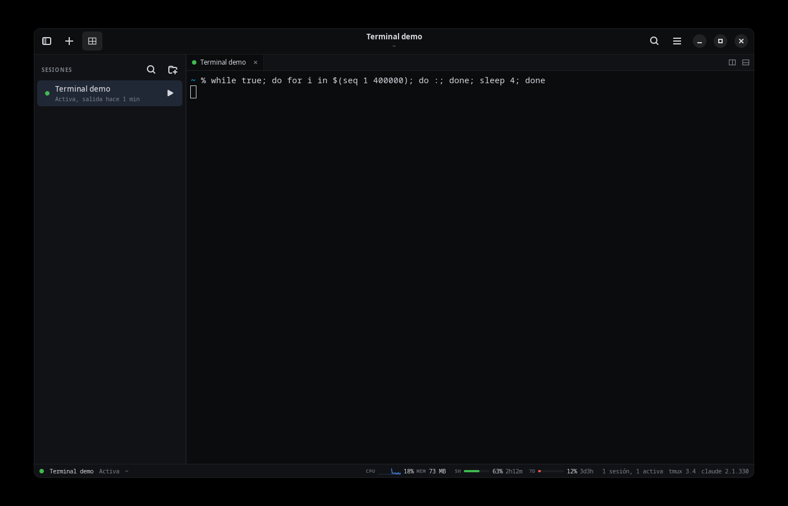

# Complementos

Un complemento es un programa externo que añade cosas a las sesiones de ALarviTerm: una etiqueta, un cronómetro y acciones propias. Sirve para conectar la aplicación con herramientas de cada cual, como un control de horas o un gestor de tareas, sin que su código tenga que vivir en este repositorio.



ALarviTerm no hace ninguna conexión de red. Si un complemento habla con un servicio, lo hace él, con sus propias credenciales, y la aplicación nunca las ve.

## Instalar uno

Cada complemento es una carpeta dentro de `~/.config/alarviterm/plugins`. Para probar el de ejemplo, un cronómetro local por sesión:

```sh
mkdir -p ~/.config/alarviterm/plugins
cp -r examples/plugins/cronometro ~/.config/alarviterm/plugins/
```

Los complementos se leen al arrancar, así que hay que reiniciar ALarviTerm. Para quitar uno, borra su carpeta. La variable `ALARVITERM_PLUGINS_DIR` cambia la carpeta donde se buscan.

Un complemento se ejecuta con tus permisos. Instala solo los que hayas leído o en los que confíes.

## Dónde aparece

* En la fila de cada sesión de la barra lateral: la etiqueta, los botones de las acciones que lo pidan y el cronómetro.
* En el menú contextual de la sesión: todas las acciones.
* En la paleta de comandos: las acciones de la sesión actual.

## El manifiesto

`plugin.json`, en la carpeta del complemento:

```json
{
  "name": "Cronómetro",
  "command": ["./cronometro.py"],
  "interval": 30,
  "timeout": 5
}
```

| Campo | Significado |
| --- | --- |
| `name` | Nombre que ve el usuario. Si falta se usa el de la carpeta. |
| `command` | Programa y argumentos fijos. Un texto o una lista. Una ruta relativa se busca en la carpeta del complemento y un nombre suelto en el `PATH`. Obligatorio. |
| `interval` | Segundos entre dos consultas de estado. Por defecto 30, mínimo 5. |
| `timeout` | Segundos que se espera una respuesta. Por defecto 10, máximo 60. |

## El contrato

La aplicación ejecuta el programa en la carpeta del complemento, le escribe un JSON por la entrada estándar y lee otro de su salida. La salida de error se descarta. Todos los campos de las respuestas son opcionales.

### Estado

```
<command> status
```

Entrada:

```json
{
  "version": 1,
  "sessions": [
    {
      "id": "65d15c75894a",
      "name": "API pagos",
      "cwd": "/home/demo/proyectos/api",
      "kind": "claude",
      "group": "Trabajo",
      "project": null,
      "alive": true
    }
  ]
}
```

`kind` es `claude` o `shell`. `group` y `project` son nombres, o `null`.

Salida:

```json
{
  "sessions": {
    "65d15c75894a": {
      "badge": "PAG 12",
      "tone": "ok",
      "timer_since": 1795302059,
      "tooltip": "Tarea en marcha",
      "actions": [
        { "id": "parar", "label": "Parar la tarea", "icon": "media-playback-stop-symbolic", "button": true },
        { "id": "ver", "label": "Abrir la tarea en la web" }
      ]
    }
  },
  "error": null
}
```

| Campo | Significado |
| --- | --- |
| `badge` | Etiqueta corta junto al nombre de la sesión. |
| `tone` | Color de la etiqueta: `ok`, `warn` o `muted`. |
| `timer_since` | Segundos Unix desde los que corre un cronómetro. La aplicación lo hace avanzar sola, sin volver a preguntar. |
| `tooltip` | Texto de ayuda de la etiqueta y del cronómetro. |
| `actions` | Acciones para esa sesión. Como mucho 12. |
| `error` | Problema que contar al usuario, por ejemplo que no hay red. Se avisa una vez mientras no cambie. |

De cada acción:

| Campo | Significado |
| --- | --- |
| `id` | Identificador. Letras sin tilde, números, guion y guion bajo, hasta 48 caracteres. Obligatorio. |
| `label` | Texto del menú y de la ayuda del botón. Obligatorio. |
| `icon` | Nombre de un icono simbólico del tema, como `media-playback-start-symbolic`. |
| `button` | Con `true` la acción tiene además un botón en la fila de la sesión. Sin icono, el botón lleva el texto. |

Las sesiones que no aparecen en la respuesta se quedan sin nada. Si el programa falla o tarda demasiado, la aplicación conserva lo último que dijo y avisa.

### Acción

```
<command> action <id>
```

Entrada:

```json
{ "version": 1, "session": { "id": "65d15c75894a", "name": "API pagos", "cwd": "/home/demo/proyectos/api", "kind": "claude", "group": "Trabajo", "project": null, "alive": true } }
```

Salida:

```json
{ "ok": true, "message": "Tarea parada.", "open_url": "https://example.org/tareas/12" }
```

| Campo | Significado |
| --- | --- |
| `ok` | Si la acción salió bien. |
| `message` | Texto que se muestra un momento al pie de la ventana. |
| `open_url` | Dirección que abrir en el navegador. Solo se aceptan `http` y `https`. |

Después de cada acción la aplicación vuelve a pedir el estado, así que los botones y el cronómetro se actualizan al momento.

## Consejos

* La consulta de estado se repite cada pocos segundos. Si el dato viene de un servicio, guarda la última respuesta un rato en vez de pedirla cada vez.
* No escribas nada más que el JSON en la salida estándar.
* Guarda tus credenciales fuera de la carpeta del complemento y con permisos solo para ti.
* El ejemplo de `examples/plugins/cronometro` cabe en una pantalla y cubre las dos órdenes.

## Y un servidor MCP

Un servidor MCP da herramientas al modelo dentro de una conversación. Un complemento da botones a la persona en la ventana. Son cosas distintas y se pueden combinar: las sesiones de ALarviTerm usan tu configuración de Claude Code tal cual, con los servidores MCP que tengas en ella.
